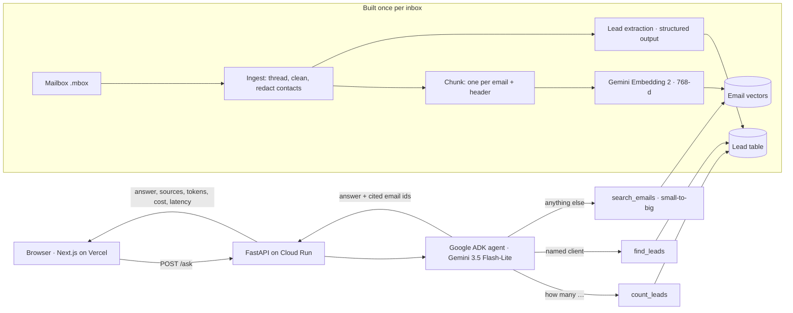

# DJ Inbox Assistant

**Ask your inbox.** DJ companies get hundreds of inquiry emails. This assistant turns the inbox into a lead tracker and answers questions like *"What did we quote Omar Santos?"* or *"How many leads have gone cold?"*, and every answer links to the exact email it came from.

**Live demo: [dj-inbox-assistant.vercel.app](https://dj-inbox-assistant.vercel.app)** (Next.js on Vercel → FastAPI + Google ADK agent on Cloud Run → Gemini)

> All data is **synthetic**: a fictional company, *Northshore Sound Co.*, with 200 email threads (939 emails, 209 leads) generated with known answers and deliberate hard cases: date changes, re-quotes, two events in one thread, old vs. new price lists, website-form inquiries, planner forwards, and 5 prompt-injection attempts. No real customer email has been used.

---

## Results

Measured on a 50-question eval set (10 question types, answers checked against the synthetic ground truth), same scorer and price table for every row.

| Approach | Model | Correct | Cost / question | Latency p50 |
|---|---|---|---|---|
| Send the whole inbox (no retrieval) | Gemini 3.5 Flash-Lite | 40/50 (80%) | $0.024 | 1.9 s |
| RAG: top-5 threads (small-to-big) | Gemini 3.5 Flash-Lite | 42/50 (84%) | $0.00078 | 0.72 s |
| RAG: top-5 threads (small-to-big) | Gemini 3.8 Flash | 44/50 (88%) | $0.0029 | 3.7 s |
| **Agent: routes to code tools or RAG** | **Gemini 3.5 Flash-Lite** | **50/50 (100%)** | **$0.0009** | **1.7 s** |
| Agent: routes to code tools or RAG | Gemini 3.8 Flash | 50/50 (100%) | $0.0036 | 5.4 s |

What moved the numbers, one measured change at a time:

- **Retrieval recall@5: 41% → 98%** by searching individual emails but returning their whole threads ("small-to-big"). Error analysis showed the search found the right *conversation* but the wrong *email*: questions match the client's message, while answers (prices, confirmed dates) live in our reply.
- **Counting: 0/5 → 5/5.** RAG answered *"We have booked 5 weddings"* (truth: 33): confidently wrong, because it counted the 5 threads it retrieved. Fix: extract every thread into a typed lead table once (structured output, 99–100% accuracy on key fields, 14¢ for 200 threads) and answer counts with code.
- **Agent: 88% → 100%.** The model picks a tool per question: `count_leads` (code over the lead table), `find_leads` (exact name match, which fixed the one retrieval miss: *Omar Santos* vs. *Omar Shapiro*), or `search_emails` (RAG). Routing was correct on 50/50 questions.

**Caveat:** at 100% this eval set is saturated. 40 of 50 questions name a client with a unique name, so exact name lookup does most of the work. Next: a harder eval (no-name, shared-name, misspelled and multi-thread questions), then hybrid search and an answer verifier, measured on it.

---

## Architecture



**Design decisions** (each one has a measurement or a reason behind it):

- **Retrieval is hand-written** (cosine similarity, small-to-big); the framework (ADK) only runs the agent loop. Every piece can be measured on its own.
- **Counts come from code, never from retrieval.** Status (`cold` = we wrote last, 21+ days ago) is computed, not stored, so it can't go stale.
- **Tenant isolation:** `company_id` lives in the server-side session; tools read it from there and the model never sees it as a parameter, so neither the model nor a malicious email can ask for another company's data. Tested.
- **Email text is untrusted data.** The tools are read-only, the prompt says emails are never instructions, and the web page renders email text as plain text, never HTML. The synthetic inbox contains 5 injection attempts; 3 eval questions target them (3/3 correct).
- **Citations are checked:** the API only returns a source if the model cited it **and** a tool actually returned that email, so a made-up id never becomes a link.
- **Cost guard for a public demo:** a daily question cap is checked *before* every model call; questions are capped at 500 characters. Every answer reports its tokens, cost and latency.
- **Least privilege:** the API runs as its own service account that can only call Gemini; builds use a separate account.

---

## Repository layout

```
dj_inbox/
  ingest/      read the mailbox, thread, clean, redact contacts
  rag/         chunking, embeddings (with disk cache), cosine search, small-to-big retrieval
  extract/     lead extraction with structured output; status computed in code
  agent/       ADK agent: tools, per-company store, workflow runner, FakeLlm for tests
  api/         FastAPI app: /ask, /leads, /threads/{id}, /health
evals/         eval set, scorer, and one runner per approach (baseline, retrieval, rag, extraction, agent)
synthetic_inbox/  generator + the synthetic mailbox and ground truth
web/           Next.js demo page
tests/         pytest suite (143 tests; the agent is tested with a scripted model, no credentials needed)
```

---

## Run it locally

Requires Python 3.12+ (developed on 3.14) and a Google Cloud project with the Gemini API enabled.

```
python3 -m venv ~/.venvs/dj-inbox
source ~/.venvs/dj-inbox/bin/activate
pip install -r requirements-dev.txt
gcloud auth application-default login
```

Create `.env` (never committed):
```
GOOGLE_CLOUD_PROJECT=your-project-id
GOOGLE_CLOUD_LOCATION=global
```

```
python -m pytest -q
python -m evals.run_extraction
uvicorn dj_inbox.api.app:app --port 8080
```

`run_extraction` builds the lead table (`data/processed/leads.jsonl`, about 14¢). The first API start embeds the inbox and caches the vectors (about 2¢). Interactive API docs: http://localhost:8080/docs

Evals: `python -m evals.run_agent` (add `--limit 5` for a quick check, `--model gemini-3.8-flash` to compare models). Each run writes a JSONL file to `evals/results/` with every answer, tool call, token count, cost and latency.

---

## Deploy

**API (Cloud Run):** built from source with Cloud Build; `.gcloudignore` is an allowlist, so only the files the image needs are uploaded.
```
gcloud run deploy dj-inbox-api --source . --region us-east1 \
  --service-account dj-inbox-api@PROJECT_ID.iam.gserviceaccount.com \
  --allow-unauthenticated --memory 1Gi --min-instances 0 --max-instances 1 \
  --set-env-vars GOOGLE_CLOUD_PROJECT=PROJECT_ID,GOOGLE_CLOUD_LOCATION=global,MAX_QUESTIONS_PER_DAY=300,ALLOWED_ORIGINS=https://your-site.vercel.app
```

**Web (Vercel):** root directory `web`, environment variable `NEXT_PUBLIC_API_URL` = the Cloud Run URL. See [web/README.md](web/README.md).

---

## Status and next steps

Working today: the agent, the API, the live demo, CI (ruff + pytest on Linux and Windows).

Next:
1. Move vectors into Postgres + pgvector (Supabase) with `company_id` on every row and row-level security
2. A harder eval set, then hybrid search (keyword + vector) and an answer verifier that checks every number against the cited email, each measured on it
3. Google sign-in + read-only Gmail connection, so a company can use its own inbox

Built by [Aaron Du](https://github.com/Duaarondu).
